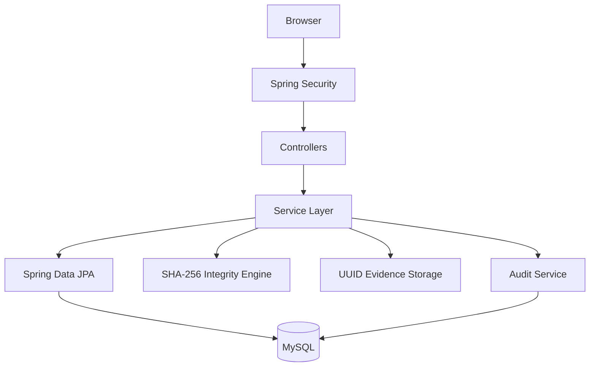

# Architecture



## Security data flow

```text
Browser
  |
  v
Spring Security (authentication + CSRF + RBAC + security headers)
  |
  v
Controller
  |
  v
Authorization policy (case owner or ADMIN)
  |
  v
Service layer
  |---------------------> AuditService -> SHA-256 audit chain
  |
  +---------------------> IntegrityService -> SHA-256 evidence verification
  |
  v
Repository / MySQL
  |
  +---------------------> Evidence metadata + verification history

Evidence bytes are stored outside the database under UUID-based filenames.
```

The application intentionally separates evidence-content integrity from audit-event integrity: SHA-256 of a file detects file-content changes, while the audit hash chain detects modifications to the recorded event stream.

## Audit visibility model
Global security audit records are an administrative security function. `ADMIN` can access the full audit stream and verify the audit hash chain. `INVESTIGATOR` cannot access `/audit`; the dashboard only exposes the investigator's own recent activity. Case/evidence-specific audit history is exposed through the existing authorization checks for the corresponding evidence/case.
